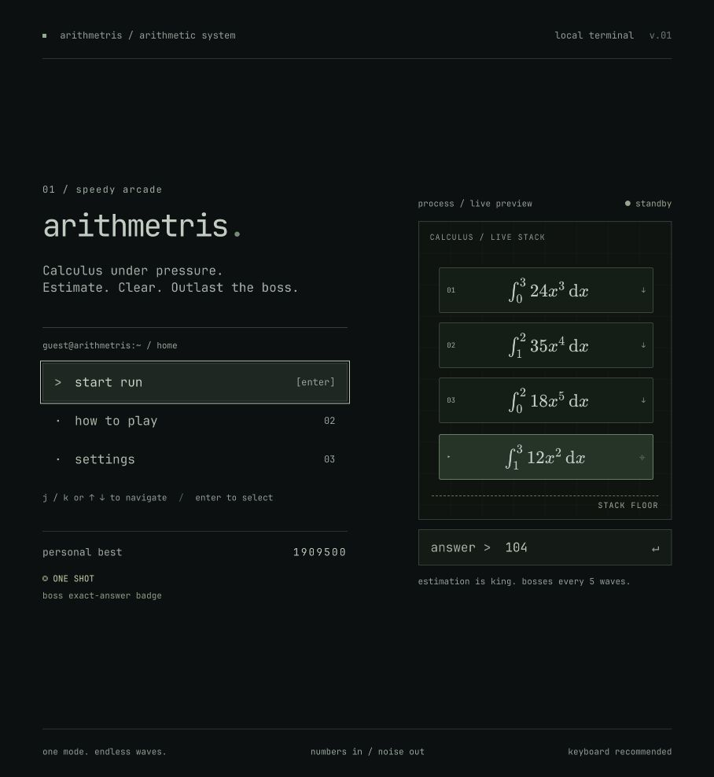
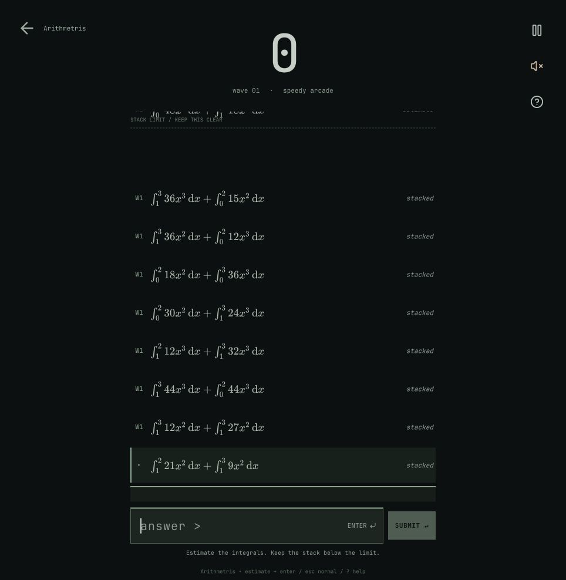

<div align="center">

# arithmetris.

**Calculus under pressure.**

Estimate. Clear the stack. Outlast the boss.

[](https://github.com/simply-sunny/arithmetris/actions/workflows/checks.yml)
**React 19 · TypeScript · Vite**



</div>

## The arcade

One mode. Endless waves. Falling definite integrals with exact integer answers—and very little time to find them. Good estimates damage the stack; exact answers clear matching equations and push survivors upward.

- **A quiet terminal aesthetic.** Charcoal, muted sage, JetBrains Mono with ligatures, and an animated boot sequence.
- **Math you can read.** KaTeX renders integral bounds and exponents, with accessible MathML.
- **A real stack.** Smooth motion, measured block collisions, and falling support when a block clears.
- **Every fifth wave, a boss.** A long equation launches cloned fragments. At half health, its integrands become their fourth derivatives.
- **ONE SHOT.** Solve the entire current boss equation exactly to defeat it instantly and unlock a persistent badge.
- **Keyboard first.** Vim-style menus, automatic answer focus, mobile keypad, quiet UI sounds, and reduced-motion support.

<details>
<summary>See the arcade layout</summary>



</details>

## Run locally

Use Node.js 24 and npm.

```sh
npm ci
npm run dev
```

Open the local address printed by Vite. Scores and achievements stay in your browser; no account or backend is required.

## Controls

| Key | Action |
| --- | --- |
| Numbers / `-` | Enter an estimate |
| `Enter` | Submit / select menu item |
| `Esc` | Pause / resume |
| `?` | Instructions |
| `m` | Toggle sound during a run |
| `j` / `k`, `h` / `l`, ↑ / ↓ | Navigate menus |
| `g` / `G` | First / last menu item |
| `Tab` / `Shift+Tab` | Standard keyboard navigation |

## Development

```sh
npm run lint
npm test
npm run build
npm run preview
```

The checks run on every push and pull request. Tests cover calculus answers against numerical integration, measured-height stacking, overflow, estimate damage, and boss transformations. `npm run build` creates the static site in `dist/`.

## Credits

The interface uses [JetBrains Mono](https://github.com/JetBrains/JetBrainsMono) under the SIL Open Font License and [KaTeX](https://katex.org/) for math rendering. Font license files are included in `public/fonts/`.

The included Freesound effects have individual licenses and attribution in [audio credits](public/audio/CREDITS.md). The processing sound is **CC BY-NC 4.0** and requires replacement or a separate license for commercial use. No blanket license is applied to third-party assets.
